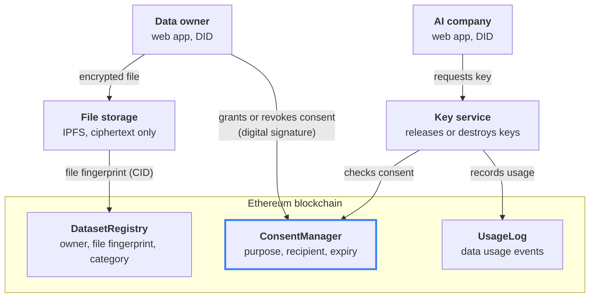
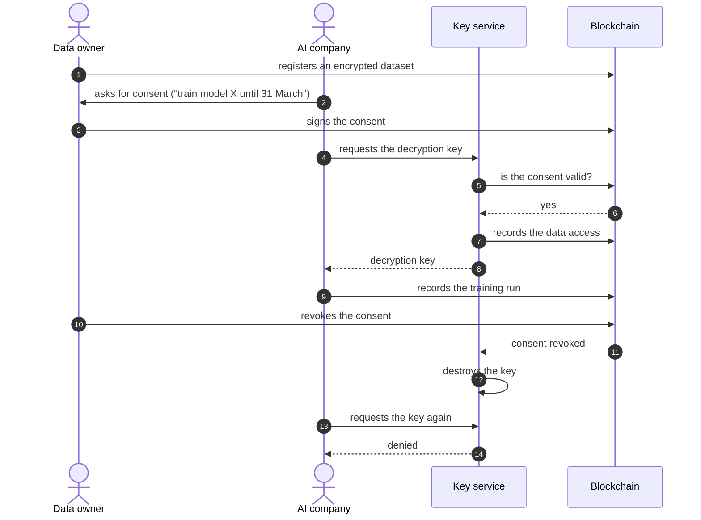

# Consent Ledger

**A tamper-proof consent registry for AI training data.** Consent Ledger lets people decide, for each AI model, whether a company may train on their data. Every consent and every use of the data is recorded on a public blockchain, so any party can verify it and nobody can change it afterwards.

## The business problem

- **AI companies must prove they had the right to use personal data.** GDPR requires a legal basis for every processing purpose. The EU AI Act requires providers to document the data their models were trained on.
- **Today, proof of consent lives in the company's own database.** The company can edit or delete those records at any time. An auditor, a regulator or a court has to take the company's word for it.
- **Data owners can't see what happens to their data.** They don't know who used it, for which model, or whether a withdrawn consent was respected.
- **Withdrawal is hard to enforce.** Once a company holds a copy of the data, "please stop using it" is only a request.

Organizations that train models on customer data feel this most: banks, telecoms and healthcare providers. They need proof of consent for every record, in a form that can't be rewritten after the fact.

## What Consent Ledger does

- **Consent is specific.** It names *who* may use the data, *for what purpose* (e.g. "train model X") and *until when*. Nothing is granted by default.
- **No consent, no access.** Data is stored encrypted. A company gets the decryption key only while it holds a valid consent.
- **Every use leaves a trace.** Each key release and each training run is written to an audit log that the data owner can see.
- **Withdrawal really works.** When the owner revokes consent, the decryption key is destroyed and the stored data becomes unreadable. The history of what was granted, used and revoked stays on record.
- **No personal data on the blockchain.** The blockchain holds only identifiers, file fingerprints and consent records. The data itself stays off-chain and encrypted.

## How it works

The data owner encrypts a dataset and stores it in IPFS. Its fingerprint is registered on the blockchain. The owner grants consent by signing it in a wallet. When an AI company asks for the data, the key service checks the consent on-chain first. It releases the decryption key only if the consent is valid, and it records that release in the audit log.

## Consent lifecycle

## Mechanisms

| Mechanism | What it gives the business |
| --- | --- |
| **Smart contracts on Ethereum** | One shared, neutral record of consents that neither the company nor the data owner can alter after the fact |
| **Decentralized identity (`did:ethr`, ERC-1056)** | People and companies are identified by keys they control, without a central account provider |
| **Signed consents (EIP-712)** | The owner approves a clearly worded consent in their wallet and pays no transaction fee. Each signature works only once, only before its deadline and only on this network, so it can't be reused or forged. |
| **Encryption (AES-GCM) + IPFS storage** | Data is stored only as ciphertext, identified by a content fingerprint (CID) that proves the file wasn't swapped |
| **Consent-gated key release** | Access to data is technically tied to a valid consent, not just to a policy document |
| **Crypto-shredding** | Revoking consent destroys the key, which makes the data unreadable everywhere it is stored. This is how a right to erasure coexists with an immutable ledger. |
| **On-chain audit log** | Every access and training run is a timestamped event that the owner, an auditor or a regulator can check |

### The three contracts

| Contract | Role |
| --- | --- |
| `DatasetRegistry` | Who owns which dataset: owner, file fingerprint (CID) and data category |
| `ConsentManager` | Who may use which dataset, for what purpose and until when; granting and revoking consent |
| `UsageLog` | When the data was accessed and which model was trained on it |

## Trust boundaries

- **Guaranteed:** only a recipient with a valid, unexpired and unrevoked consent receives the decryption key, and every release is on record.
- **Not guaranteed:** the system can't stop a company from keeping a copy of data it already decrypted, or a model it already trained. The audit log makes that use provable, not impossible.
- **Key service:** the key service is a trusted party in the current design. It can be replaced by a decentralized key network that releases keys based on contract state, such as Lit Protocol.
